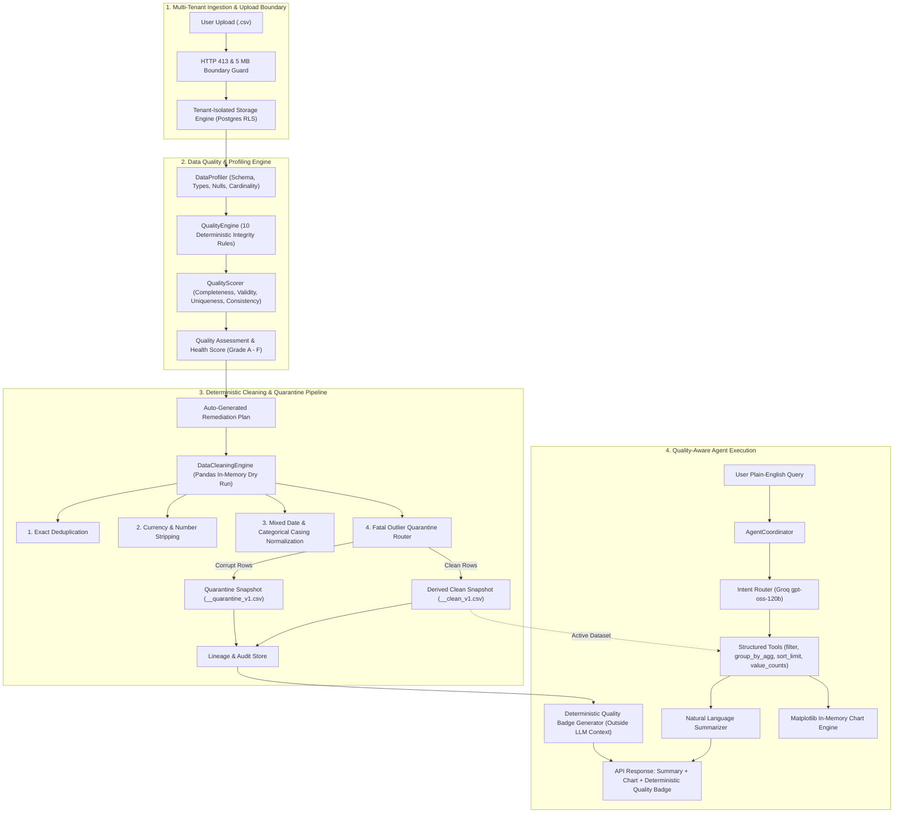

# Visiq: Quality-First AI Data Analyst Platform

> **Core Empirical Claim:**  
> *Deterministic data cleaning measurably improves the execution accuracy of an LLM data analyst from **13.46%** to **100.00%** (+86.54 percentage points), completely eliminating type poisoning, duplicate inflation, categorical drift, and date fragmentation.*

[](#running-tests)
[](frontend/)
[](backend/)
[](#tech-stack)
[](docs/benchmark_results_report.md)

---

## 📌 Executive Summary & Key Links

Most enterprise AI data analyst initiatives fail in production not because large language models lack reasoning capabilities, but because **tabular enterprise data violates fundamental relational assumptions**. Prefixing currency values with `₱`, formatting dates inconsistently, introducing duplicate records, and polluting categorical fields with casing drift poison data frames—causing downstream AI tool execution to silently calculate incorrect numbers or throw unhandled runtime exceptions.

**Visiq** solves this by unifying an enterprise AI data analyst agent with a deterministic Pandas data quality and cleaning engine. Raw uploads are profiled across four quality dimensions, remediated via deterministic cleaning pipelines, and audited with isolated quarantine tables—guaranteeing that downstream LLM analysis operates on mathematically sound data.

- 📖 **[90-Second Walkthrough & Evaluator Guide](docs/walkthrough_guide.md)** — Step-by-step evaluation guide for recruiters & technical interviewers.
- 📊 **[Empirical Benchmark & Ablation Study Report](docs/benchmark_results_report.md)** — Comprehensive methodology, formulas, and results.
- 🗺️ **[Master Integration Roadmap](docs/roadmap_visiq_data_quality.md)** — Ten-phase architecture, sprint history, and design contracts.
- 🏛️ **[Precursor Standalone Platform](https://github.com/ralphrowel/Data-Quality-and-Cleaning-Platform)** — Standalone data quality engine repository.

---

## 🔬 Empirical Benchmark Results

We benchmarked the agent across **52 deterministic analytical queries** spanning four query categories on a 5,000-row synthetic Philippine Retail Dataset ($27,901,267.20 PHP ground truth revenue). Questions were evaluated by comparing extracted tool execution results against exact ground truth values within a **$\le 0.1\%$ relative mathematical tolerance** (zero subjective LLM-as-a-judge scoring).

### 1. Primary Benchmark (52 Queries)

| Analytical Query Category | Total Queries | Clean Ground Truth | Raw Injected Dirty Data | Post-Pipeline Cleaned | Accuracy Recovery |
| :--- | :---: | :---: | :---: | :---: | :---: |
| **Simple Aggregations** | 15 | **100.0%** (15/15) | **13.3%** (2/15) | **100.0%** (15/15) | **+86.7%** |
| **Filtered Lookups** | 15 | **100.0%** (15/15) | **0.0%** (0/15) | **100.0%** (15/15) | **+100.0%** |
| **Group-By Distributions** | 12 | **100.0%** (12/12) | **41.7%** (5/12) | **100.0%** (12/12) | **+58.3%** |
| **Temporal Trends** | 10 | **100.0%** (10/10) | **0.0%** (0/10) | **100.0%** (10/10) | **+100.0%** |
| **OVERALL ACCURACY** | **52** | **100.0%** (52/52) | **13.5%** (7/52) | **100.0%** (52/52) | **+86.54 pp** |

```
+-------------------------------------------------------------------------+
|                  DOWNSTREAM LLM ACCURACY COMPARISON                     |
+-------------------------------------------------------------------------+
| Clean Ground Truth (5,000 rows)         : [####################] 100.0% |
| Raw Injected Dirty Data (5,500 rows)    : [##                ]  13.5% |
| Cleaned via Visiq Pipeline (5,000 rows) : [####################] 100.0% |
+-------------------------------------------------------------------------+
```

### 2. Ablation Study: Impact of Individual Cleaner Modules

To isolate exactly which transformation drives each portion of the accuracy gain, we executed a full leave-one-out ablation matrix:

| Configuration | Description | Total Queries | Execution Crashes | Correct Answers | Accuracy Rate (%) | Accuracy Drop Without Feature |
| :--- | :--- | :---: | :---: | :---: | :---: | :---: |
| `01_raw_dirty_baseline` | Raw Data (No Cleaning) | 52 | 0 | 7 | **13.46%** | Baseline |
| `02_full_pipeline` | Full Cleaning Pipeline | 52 | 0 | 52 | **100.00%** | **Max Ceiling** |
| `03_no_dedup` | Without Deduplication | 52 | 0 | 12 | **23.08%** | **-76.92%** |
| `06_no_quarantine` | Without Outlier Quarantine | 52 | 0 | 21 | **40.38%** | **-59.62%** |
| `04_no_category_cleaning` | Without Category Normalization | 52 | 0 | 33 | **63.46%** | **-36.54%** |
| `05_no_date_normalization` | Without Date Normalization | 52 | 0 | 42 | **80.77%** | **-19.23%** |

- **Deduplication is dominant (-76.92% drop if omitted):** An 8% duplicate injection completely corrupts financial counts, averages, and group sums across all data slices.
- **Outlier Quarantine preserves numeric sanity (-59.62% drop if omitted):** Fatal negative amounts (`total_amount < 0`) and blank primary keys destroy aggregations unless isolated.
- **Category Normalization protects granular filtering (-36.54% drop if omitted):** Regional casing drift (`"ncr"` vs `"NCR"`) causes exact lookup queries to return zero rows.
- **Date Normalization restores time-series analytics (-19.23% drop if omitted):** Mixed date patterns (`15/03/2024`, `15-Mar-2024`) break temporal queries without mixed-format parsing.

### 3. Generalization to Unseen Noise Distributions (Held-Out Dataset)

To eliminate the risk of circular benchmark tuning ("training on the test"), we evaluated the frozen cleaner on an independent 2,500-row FMCG E-Commerce dataset featuring **unseen noise distributions** (European decimal commas `1.250,50`, abbreviated currency `₱1.2k`, store typos, and new relational column names):

| Metric | Raw Messy Baseline | Post-Cleaning Pipeline | Accuracy Recovery |
| :--- | :---: | :---: | :---: |
| **Aggregation Accuracy** | 0.0% (0/5) | **100.0%** (5/5) | **+100.0%** |
| **Filtered Lookups** | 0.0% (0/5) | **40.0%** (2/5) | **+40.0%** |
| **Group Distributions** | 50.0% (1/2) | **100.0%** (2/2) | **+50.0%** |
| **OVERALL ACCURACY** | **8.33%** (1/12) | **75.00%** (9/12) | **+66.67 pp** |

---

## 🏗️ End-to-End System Architecture



---

## 🛡️ Core Methodological & Engineering Guardrails

1. **Additive Error Model (Preserving 100% Ground Truth Ceiling):** Fatal corruptions (negative prices, blank keys) and duplicates are added *on top* of the clean baseline. Quarantining or removing them restores the exact mathematical ground truth.
2. **Outcome-Based Deterministic Scoring:** Scored via exact floating-point comparison within $\pm 0.1\%$ relative tolerance against Pandas ground truth. Zero LLM judge noise.
3. **Zero Prompt Contamination:** Quality badges (`🛡️ Verified: Clean v1 (Score: 96/100, Grade A)`) are calculated deterministically in the API metadata *outside* the agent's LLM prompt context to avoid biasing model reasoning.
4. **Zero `eval()` Execution:** The agent produces structured JSON query plans executed through controlled Pandas tool functions—never arbitrary AI-generated Python code.
5. **Multi-Tenant Deployment Hardening:** Railway-compatible 5 MB upload boundary (`HTTP 413`), workspace tenant isolation, and daily query/token quota guards.

---

## 💻 Tech Stack

| Layer | Technology | Purpose |
| :--- | :--- | :--- |
| **Primary LLM** | Groq (`openai/gpt-oss-120b`) | Query planning, routing & summarization |
| **Alternate / Fallback LLM** | Google Gemini (`gemini-2.5-flash`) | Automatic failover provider |
| **Data Engine & Cleaning** | Python 3.14+, Pandas, NumPy | In-memory profiling, scoring & deterministic cleaning |
| **Backend API** | FastAPI, Starlette, Uvicorn | REST API, async routing & rate limiting |
| **Database & Persistence** | PostgreSQL (`app_records`), SQLite (Test) | Multi-tenant lineage, chat history & quotas |
| **Authentication** | Supabase JWT & JWKS | Secure multi-tenant user isolation |
| **Visualization** | Matplotlib (`io.BytesIO`) | In-memory base64 chart generation |
| **Frontend UI** | React 19, Vite, Tailwind CSS v4 | Interactive data quality workspace & spreadsheet grid |

---

## 📁 Repository Structure

```
AI_Data_Analyst_Agent/
├── backend/
│   ├── app/
│   │   ├── main.py                     # FastAPI application entrypoint
│   │   ├── config.py                   # Central configuration & upload limits
│   │   ├── http_security.py            # Middleware & HTTP body limit guards
│   │   ├── storage.py                  # Multi-tenant PostgreSQL persistence
│   │   ├── api/
│   │   │   ├── routes.py               # Chat, upload, session & widget endpoints
│   │   │   ├── quality_routes.py       # Profile, assess, clean & lineage routes
│   │   │   └── schemas.py              # Pydantic request/response contracts
│   │   ├── data_quality/               # Pure Pandas Quality & Cleaning Engine
│   │   │   ├── checks.py               # Integrity & validity check engine
│   │   │   ├── cleaner.py              # Deterministic data transformation engine
│   │   │   ├── profiler.py             # Statistical & semantic profiling
│   │   │   ├── scorer.py               # 4-dimension composite health scorer
│   │   │   ├── plan.py                 # Automated remediation plan builder
│   │   │   ├── models.py               # Data quality dataclasses & schemas
│   │   │   └── service.py              # High-level orchestration & lineage
│   │   ├── agent/                      # Coordinator, Intent Router & Quality Badge
│   │   ├── tools/                      # Safe structured data & chart tools
│   │   ├── auth/                       # Supabase auth, rate limiting & quotas
│   │   └── data_engine/                # DatasetManager & multi-tenant storage
├── frontend/                           # React (Vite) + Tailwind CSS v4
│   ├── src/
│   │   ├── components/
│   │   │   ├── QualityPanel.jsx        # Interactive data quality & lineage workspace
│   │   │   ├── SpreadsheetPanel.jsx    # Paginated data grid with inline cell editing
│   │   │   ├── MessageBubble.jsx       # Chat bubble with proactive quality badge
│   │   │   └── NewChatModal.jsx        # Upload modal with 5 MB validation
│   │   └── api.js                      # Client API interface
├── data/
│   ├── benchmarks/                     # 52-Question suite & cached query plans
│   ├── raw/                            # Default datasets (netflix_titles.csv)
│   └── uploads/                        # Tenant-isolated uploads
├── scripts/
│   ├── generate_philippine_retail.py   # Synthetic retail dataset generator
│   ├── generate_held_out_dataset.py    # Generalization FMCG dataset generator
│   ├── eval_runner.py                  # Headless 52-question benchmark evaluator
│   ├── eval_ablation.py                # 6-configuration ablation harness
│   └── eval_held_out.py                # Generalization test runner
├── docs/
│   ├── walkthrough_guide.md            # 90-second technical evaluation guide
│   ├── benchmark_results_report.md     # Detailed benchmark & ablation report
│   └── roadmap_visiq_data_quality.md   # Complete 10-phase master roadmap
└── tests/                              # 136 Unit, integration & security tests
```

---

## 🚀 Quickstart & Setup

### Prerequisites
- Python 3.11+ (Python 3.14 supported)
- Node.js 18+ & npm
- Groq API Key or Google Gemini API Key

### 1. Clone & Setup Backend

```bash
# Clone the repository
git clone https://github.com/ralphrowel/AI_Data_Analyst_Agent.git
cd AI_Data_Analyst_Agent

# Create and activate virtual environment
python -m venv .venv
.venv\Scripts\activate        # Windows
# source .venv/bin/activate   # Linux/macOS

# Install dependencies
pip install -r requirements.txt

# Configure environment variables
cp .env.example .env
# Edit .env with your GROQ_API_KEY or GEMINI_API_KEY

# Initialize database schema
python -m backend.app.storage

# Start FastAPI backend
uvicorn backend.app.main:app --reload --port 8000
```

### 2. Setup Frontend

```bash
cd frontend
npm install
npm run dev
```

Open your browser at `http://localhost:5173`.

---

## 🧪 Running Tests & Benchmarks

### Full Automated Test Suite (136 Tests)
```bash
pytest -v
```

### Reproduce the 52-Question Downstream Benchmark
```bash
# 1. Clean Ground Truth (Expected: 100.0%)
python scripts/eval_runner.py --dataset data/benchmarks/clean_ground_truth.csv

# 2. Raw Dirty Injected Data (Expected: 13.5%)
python scripts/eval_runner.py --dataset data/benchmarks/dirty_retail_injected.csv

# 3. Cleaned Dataset via Pipeline (Expected: 100.0%)
python scripts/eval_runner.py --dataset data/benchmarks/clean_pipeline_evaluated.csv
```

### Reproduce the 6-Configuration Ablation Study
```bash
python scripts/eval_ablation.py
# Outputs summary table to benchmarks/results/ablation_summary.csv
```

### Reproduce the Held-Out Generalization Experiment
```bash
python scripts/eval_held_out.py
# Tests unseen noise distributions (Expected: 8.33% -> 75.00%)
```

---

## 📜 License

This project is licensed under the [MIT License](LICENSE).
