# Visiq Architecture & Route Flow Chart

```mermaid
flowchart TD
    %% Styling Classes
    classDef client fill:#3b82f6,stroke:#1d4ed8,stroke-width:2px,color:#ffffff;
    classDef route fill:#8b5cf6,stroke:#6d28d9,stroke-width:2px,color:#ffffff;
    classDef engine fill:#10b981,stroke:#047857,stroke-width:2px,color:#ffffff;
    classDef storage fill:#f59e0b,stroke:#b45309,stroke-width:2px,color:#ffffff;
    classDef decision fill:#ec4899,stroke:#be185d,stroke-width:2px,color:#ffffff;
    classDef llm fill:#06b6d4,stroke:#0e7490,stroke-width:2px,color:#ffffff;

    %% STAGE 1: INGESTION & UPLOAD
    subgraph STAGE_1["1. Ingestion & Workspace Initialization"]
        USER_UP["User Uploads CSV or Markdown"]:::client
        USER_UP --> R_UPLOAD["POST /api/upload"]:::route
        R_UPLOAD --> CHK_SIZE{"Size <= 5 MB?"}:::decision
        CHK_SIZE -- "> 5 MB" --> ERR_413["HTTP 413: Upload Exceeds Limit"]
        CHK_SIZE -- "<= 5 MB" --> CHK_TYPE{"File Type?"}:::decision
        CHK_TYPE -- ".md / .txt" --> RAG_STORE["FileStore: Save Knowledge Doc\nAuto-trigger RAG Indexing"]:::storage
        CHK_TYPE -- ".csv" --> FS_SAVE["FileStore: Save Raw CSV\n(Supabase Storage or data/uploads/)"]:::storage
        FS_SAVE --> R_CREATE_SESS["POST /api/sessions"]:::route
        R_CREATE_SESS --> INIT_SESS["SessionStore: Initialize Workspace Session\nCache In-Memory DataFrame"]:::engine
    end

    %% STAGE 2: DATA QUALITY & PROFILING
    subgraph STAGE_2["2. Data Quality Profiling & Assessment"]
        INIT_SESS --> R_QUAL["GET /api/datasets/{name}/quality"]:::route
        R_QUAL --> CHK_HASH{"Fingerprint Cache Hit in app_records?"}:::decision
        CHK_HASH -- "Yes (Cache Hit)" --> RET_CACHE["Return Cached Quality Assessment"]:::storage
        CHK_HASH -- "No / Refresh" --> RUN_PROF["DataProfiler: Column Types, Nulls, Distincts"]:::engine
        RUN_PROF --> RUN_CHECKS["DataQualityEngine: 10 Deterministic Integrity Rules"]:::engine
        RUN_CHECKS --> RUN_SCORE["DataQualityScorer: 6 Dimensions\nCompleteness, Uniqueness, Validity,\nConsistency, Accuracy, Integrity"]:::engine
        RUN_SCORE --> COMPUTE_GRADE["Compute Overall Health Score (0-100)\nAssign Grade (A, B, C, D, F)"]:::engine
        COMPUTE_GRADE --> AUTO_PLAN["generate_suggested_plan: Deterministic Remediation Rules"]:::engine
        AUTO_PLAN --> STORE_ASSESS["Cache Report in Database\n(Supabase PostgreSQL or SQLite visiq.db)"]:::storage
        STORE_ASSESS --> UI_HEALTH["UI: Render Health Badge Pill & Issues Drawer"]:::client
    end

    %% STAGE 3: DETERMINISTIC CLEANING & QUARANTINE
    subgraph STAGE_3["3. Deterministic Remediation & Lineage Engine"]
        UI_HEALTH --> DECIDE_CLEAN{"Quality Score < 85 or User Requests Clean?"}:::decision
        DECIDE_CLEAN -- "Preview Plan" --> R_PREVIEW["POST /api/datasets/{name}/clean/preview"]:::route
        R_PREVIEW --> DRY_RUN["DataCleaningEngine: In-Memory Dry Run\nCalculate Diff & Before/After Score Delta"]:::engine
        DRY_RUN --> SHOW_PREV["UI: Display Before/After Comparison Modal"]:::client
        
        SHOW_PREV --> R_APPLY["POST /api/datasets/{name}/clean"]:::route
        DECIDE_CLEAN -- "Apply Immediately" --> R_APPLY
        
        R_APPLY --> PIPE_RUN["Execute 10-Stage Deterministic Pipeline:\n1. Column Headers & Whitespace\n2. Categorical Casing & Aliases\n3. Date Normalization (ISO-8601)\n4. Currency & Numeric Stripping\n5. Deduplication & Missing Imputation\n6. Outlier Quarantine Router"]:::engine
        
        PIPE_RUN --> SPLIT_DATA{"Are Corrupt Records Present?"}:::decision
        SPLIT_DATA -- "Fatal Records (Negative totals, blank IDs)" --> QUAR_FILE["Save Quarantine Table:\n{stem}__quarantine_v1.csv"]:::storage
        SPLIT_DATA -- "Clean Records" --> CLEAN_FILE["Save Immutable Clean Snapshot:\n{stem}__clean_v1.csv"]:::storage
        
        CLEAN_FILE --> REC_JOB["Record CleaningJob Audit Trail"]:::storage
        QUAR_FILE --> REC_JOB
        REC_JOB --> REC_LIN["Update DatasetLineage:\nOriginal (v0) -> Child Clean (v1)"]:::storage
        
        REC_LIN --> R_SWITCH["PATCH /api/sessions/{session_id}/dataset"]:::route
        R_SWITCH --> SWITCH_DF["SessionStore: Hot-Swap Active Workspace DataFrame\nPoint Session to Clean Snapshot"]:::engine
    end

    %% STAGE 4: QUALITY-AWARE ANALYTICS AGENT
    subgraph STAGE_4["4. Quality-Aware Agent Execution (Zero eval, Zero Contamination)"]
        SWITCH_DF --> USER_QUERY["User Submits Natural Language Query"]:::client
        DECIDE_CLEAN -- "Skip Cleaning (Use Raw)" --> USER_QUERY
        
        USER_QUERY --> R_ASK["POST /api/ask"]:::route
        R_ASK --> CHK_QUOTA{"Daily Quota Remaining?\n(50k tokens / 10 queries)"}:::decision
        CHK_QUOTA -- "Exceeded" --> ERR_429["HTTP 429: Quota Limit Exceeded"]
        CHK_QUOTA -- "Permitted" --> ROUTER["QueryRouter: LLM Intent Classification"]:::engine
        
        ROUTER --> INTENT{"Classified Intent?"}:::decision
        
        INTENT -- "rag" --> RAG_SEARCH["RAGRetriever: Semantic Document Vector Search"]:::engine
        INTENT -- "structured" --> LLM_PLAN["LLM Plan (Groq gpt-oss-120b / Gemini Dual-Key):\nSelect Tool & JSON Parameters"]:::llm
        INTENT -- "hybrid" --> HYBRID_PLAN["Execute Structured Tool + RAG Search"]:::engine
        
        LLM_PLAN --> TOOL_EXEC{"ToolRegistry: Execute Tool on Active Clean DataFrame (Zero eval)"}:::engine
        
        TOOL_EXEC --> T_AGG["aggregate_data"]:::engine
        TOOL_EXEC --> T_FILTER["filter_rows"]:::engine
        TOOL_EXEC --> T_GROUP["group_data"]:::engine
        TOOL_EXEC --> T_SORT["sort_data"]:::engine
        TOOL_EXEC --> T_SCHEMA["get_dataset_schema"]:::engine
        TOOL_EXEC --> T_DQ["get_quality_report"]:::engine
        
        T_AGG --> TOOL_OUT["Pandas Execution Result"]:::engine
        T_FILTER --> TOOL_OUT
        T_GROUP --> TOOL_OUT
        T_SORT --> TOOL_OUT
        T_SCHEMA --> TOOL_OUT
        T_DQ --> TOOL_OUT
        RAG_SEARCH --> TOOL_OUT
        HYBRID_PLAN --> TOOL_OUT
        
        TOOL_OUT --> GEN_CHART["ChartTool: Generate Matplotlib Spec\nExtract SVG + Base64 PNG"]:::engine
        TOOL_OUT --> GEN_SUMM["LLM Summarizer: Plain-English Insights"]:::llm
        
        GEN_SUMM --> DET_BADGE["_resolve_quality_badge (Deterministic Engine):\nEvaluate Active Dataset Version Role & Score\nCALCULATED OUTSIDE LLM CONTEXT"]:::engine
        
        GEN_CHART --> ASSEMBLE["Assemble AnalysisResponse JSON:\n- Plain English Summary\n- Interactive Chart SVG / PNG\n- Operation Spec JSON\n- Deterministic Quality Badge Metadata"]:::engine
        DET_BADGE --> ASSEMBLE
        
        ASSEMBLE --> ATOMIC_REC["QuotaManager: Atomically Record Query & Tokens"]:::storage
        ATOMIC_REC --> SESS_REC["SessionStore: Add User & Assistant Turns to History"]:::storage
        SESS_REC --> UI_RESP["UI: Render Answer Message + Interactive Chart + Quality Badge Pill"]:::client
    end

    %% STAGE 5: DASHBOARD & ZERO-AI RECOMPUTE
    subgraph STAGE_5["5. Dashboard Visualization & Zero-AI Recompute"]
        UI_RESP --> PIN_WIDGET["POST /api/sessions/{id}/widgets/pin"]:::route
        PIN_WIDGET --> SAVE_WIDGET["SessionStore: Persist Widget Spec in Dashboard"]:::storage
        SAVE_WIDGET --> UI_DASH["Live Dashboard View"]:::client
        
        UI_DASH --> DATA_CHANGE{"Dataset Mutated?\n(Cell Edit / Row Add / Version Switch)"}:::decision
        DATA_CHANGE -- "Yes" --> R_RECOMP["POST /api/sessions/{id}/widgets/recompute"]:::route
        R_RECOMP --> ZERO_AI["WidgetEngine: Re-execute Cached Specs against active DataFrame\nRegenerate Charts with ZERO LLM Calls"]:::engine
        ZERO_AI --> DASH_UPDATE["Dashboard Updates Instantly with 0 Tokens Consumed"]:::client
    end
```

---

## Complete API Route to Architecture Mapping

| Step in Flow | API Route | Method | Purpose in Architecture | Key Data Artifacts |
| :---: | :--- | :---: | :--- | :--- |
| **1** | `/api/upload` | `POST` | Ingestion guardrail, size validation (5 MB), tenant file persistence. | Raw file in `FileStore`, metadata in database. |
| **2** | `/api/sessions` | `POST` | Initializes workspace chat session scoped to dataset. | `SessionStore` session record with in-memory DataFrame. |
| **3** | `/api/datasets/{name}/quality` | `GET` | Computes or returns cached 6-dimension data quality score & suggested plan. | `QualityAssessmentResult` (Score 0-100, Grade A-F). |
| **4** | `/api/datasets/{name}/clean/preview` | `POST` | In-memory dry run comparing before/after stats without persisting files. | Diff metrics, score delta, audit preview. |
| **5** | `/api/datasets/{name}/clean` | `POST` | Executes 10-stage deterministic cleaning pipeline, isolating corrupt rows. | Derived `{stem}__clean_v1.csv` & `{stem}__quarantine_v1.csv`. |
| **6** | `/api/datasets/{name}/lineage` | `GET` | Fetches provenance tree and derivation hierarchy. | `DatasetLineage` object (Original $\rightarrow$ Clean v1 $\rightarrow$ v2). |
| **7** | `/api/sessions/{id}/dataset` | `PATCH` | Hot-swaps the active dataset of the session to the clean snapshot. | Updated session pointing to clean DataFrame. |
| **8** | `/api/ask` | `POST` | Agent pipeline: Intent routing $\rightarrow$ Structured tool execution $\rightarrow$ Chart $\rightarrow$ Summarize $\rightarrow$ Quality badge attachment. | `AnalysisResponse` with text, chart SVG, and deterministic quality badge. |
| **9** | `/api/sessions/{id}/widgets/pin` | `POST` | Pins an analytical chart insight to the live dashboard. | Persistent widget spec JSON in session. |
| **10** | `/api/sessions/{id}/widgets/recompute`| `POST` | Re-executes cached widget specs against mutated data with **0 LLM calls**. | Updated chart SVGs with zero token consumption. |

---

## Architectural Core Tenets

1. **Deterministic Quality Isolation (Outside LLM Context):** The LLM agent is never asked to judge its own data quality. Quality scores and badges are computed mathematically by `DataQualityScorer` and attached by the route coordinator, completely preventing prompt contamination.
2. **Strict Zero-`eval()` Security:** The agent generates strictly typed JSON tool parameters for pre-registered Pandas functions (`filter_rows`, `aggregate_data`, `group_data`, `sort_data`), preventing arbitrary code injection.
3. **Additive Error Model & Pure Lineage:** Injected benchmark errors are additive, allowing the deterministic cleaner and quarantine router to restore ground truth with 100% precision without mutating the original source file.
4. **Self-Healing Storage Resiliency:** When cloud PostgreSQL is unreachable, the system automatically falls back to local SQLite at `data/visiq.db`, guaranteeing continuous operation.
