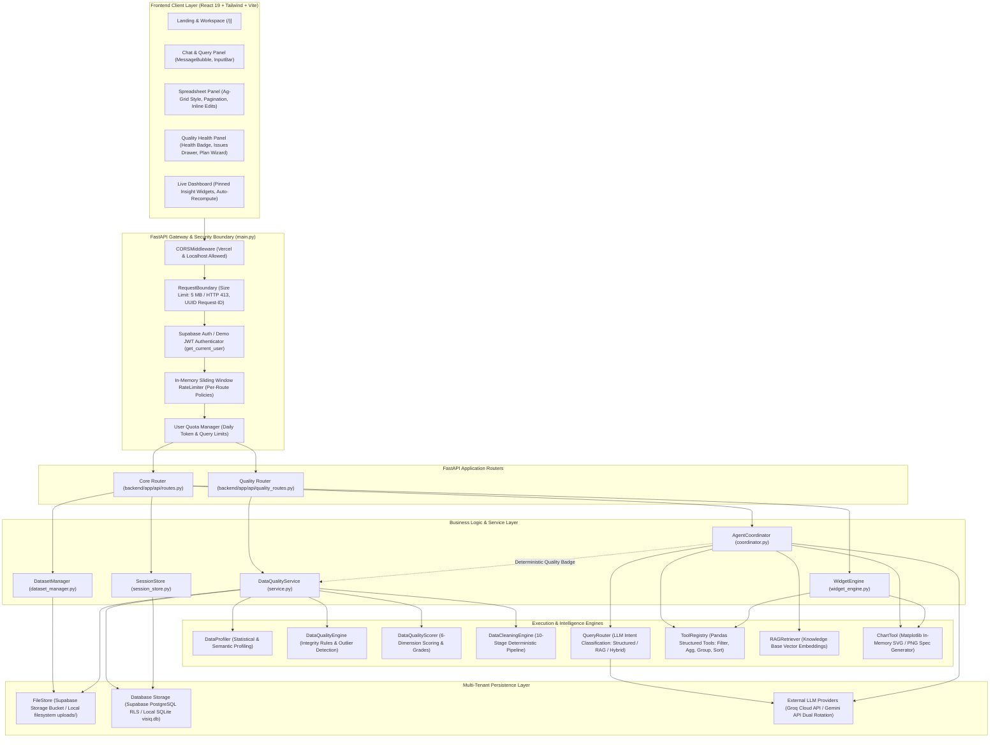
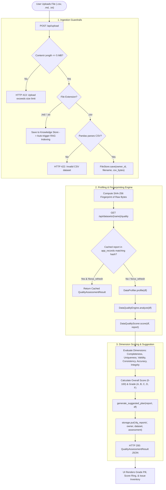
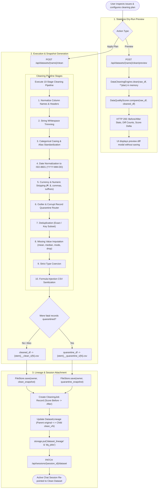
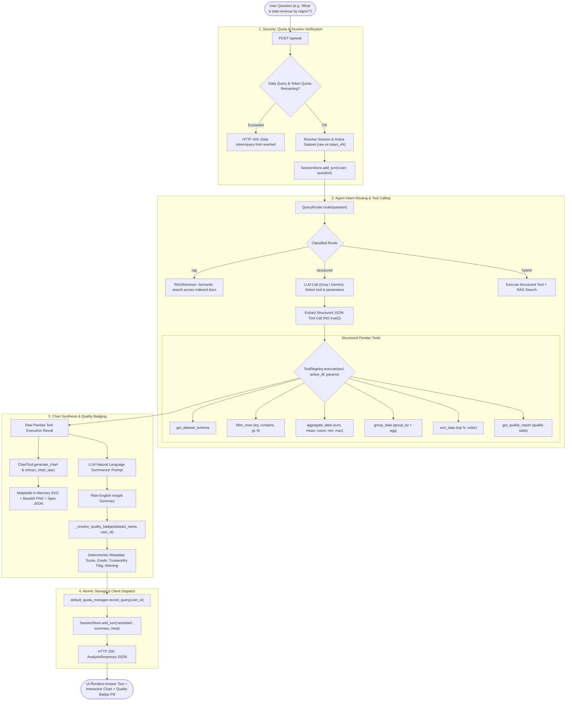
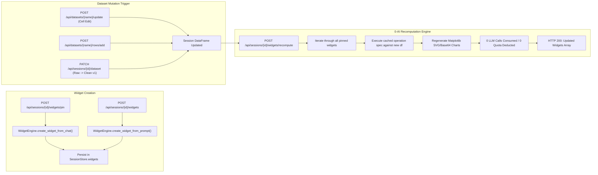
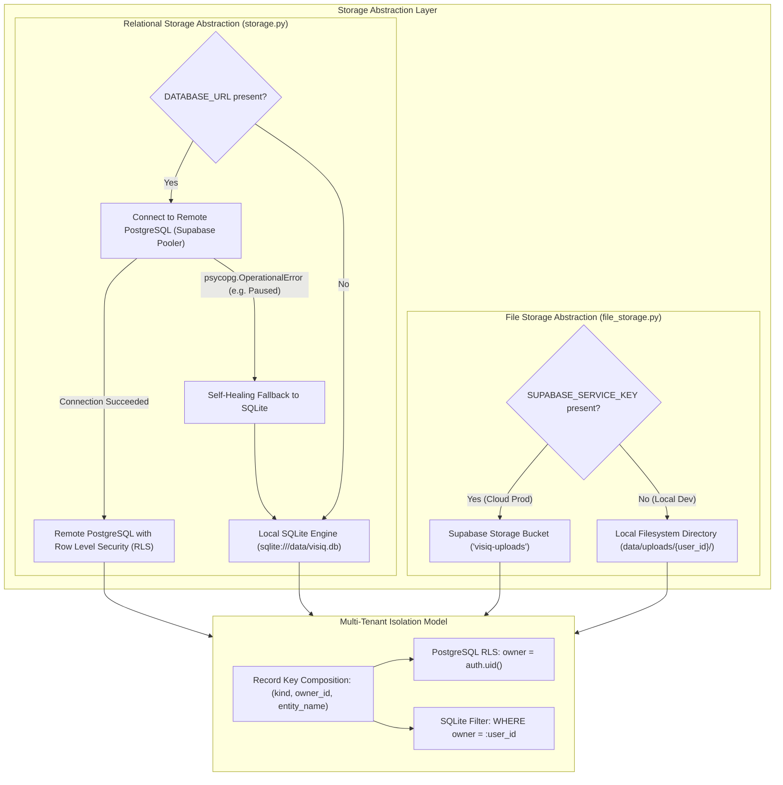

# Visiq Architecture Flow & API Route Topology

> **Comprehensive Architectural Blueprint & Routing Specification**  
> *Documenting the unified system architecture of Visiq after integrating the deterministic Data Quality & Cleaning Suite with the Quality-Aware Autonomous AI Data Analyst Agent.*

---

## 1. Executive Overview & System Topology

Visiq unifies two foundational systems into a single, cohesive, multi-tenant enterprise data platform:

1. **Deterministic Data Quality & Cleaning Engine:** A rule-based, mathematically verifiable pipeline built on Pandas and NumPy that evaluates tabular datasets across six core quality dimensions, generates remediation plans, and executes immutable transformations while isolating irrecoverable records into dedicated quarantine tables.
2. **Quality-Aware Autonomous AI Data Analyst Agent:** An intelligent analytical coordinator powered by high-throughput LLMs (Groq `gpt-oss-120b` and Google Gemini `gemini-2.5-flash` with dual-key rotation) that generates structured JSON tool execution plans against Pandas DataFrames—completely avoiding arbitrary code `eval()` and deterministically attaching dataset quality badges outside the LLM context to prevent prompt contamination.

---

## 2. End-to-End Architectural Flowcharts

### 2.1 Data Ingestion, Profiling & Health Assessment Flow

When a user uploads a new dataset or requests a quality health check, the system executes an automated profiling and scoring pass. Assessment results are indexed by dataset content hash (SHA-256 fingerprint), enabling instant cached retrieval on subsequent requests without recomputing.

---

### 2.2 Deterministic Cleaning, Quarantine & Lineage Flow

Cleaning in Visiq is **stateless, deterministic, and non-destructive**. The original dataset is never overwritten. Instead, the engine creates an immutable child version (`{stem}__clean_v{N}.csv`), isolates unrecoverable records into `{stem}__quarantine_v{N}.csv`, and registers full lineage relationships in the database.

---

### 2.3 Quality-Aware Analytics Agent Query Execution Flow

When a user submits an analytical question via `POST /api/ask`, the coordinator processes the request through intent routing, structured tool execution, and dynamic chart extraction. To preserve mathematical integrity, **the quality badge is calculated deterministically outside the LLM context**, preventing model hallucination or prompt contamination.

---

### 2.4 Live Dashboard Widgets & Zero-AI Auto-Recompute Flow

Widgets pinned to a session dashboard execute dynamic analytical operations against the session's underlying dataset. If a dataset is edited in the spreadsheet or switched from raw to clean, **widgets can be recalculated with zero LLM API consumption**.

---

## 3. Unified API Route Directory & Specifications

The table below catalogs every endpoint across the application, detailing router origin, security policies, payload contracts, service dependencies, and roles in the integrated system.

| HTTP Method | Route Path | Router Module | Auth / Rate Limit Policy | Request Body / Query Params | Primary Service Invoked | Response Output | Architectural Role |
| :--- | :--- | :--- | :--- | :--- | :--- | :--- | :--- |
| `GET` | `/` | `routes.py` | Public | None | None | `{"status": "...", "architecture": "modular"}` | Root service health check and gateway availability probe. |
| `GET` | `/api/auth/me` | `routes.py` | `get_current_user` | None | `default_quota_manager` | User profile object + daily token/query quota allowance. | Hydrates client authentication state and user header pill. |
| `GET` | `/api/user/quota` | `routes.py` | `get_current_user` | None | `default_quota_manager` | `UserQuotaResponse` (used, limit, remaining). | Real-time rate and quota usage tracking in the client header. |
| `POST` | `/api/auth/login` | `routes.py` | Public | `LoginRequest` (`username`, `password`) | Password verification | JWT token string + User object | Administrator and internal demo credentials login. |
| `GET` | `/api/datasets` | `routes.py` | `get_current_user` | None | `default_dataset_manager` | `List[DatasetInfo]` | Lists all accessible global datasets and private user uploads. |
| `POST` | `/api/upload` | `routes.py` | `get_current_user`, RateLimit (5/min) | `UploadDatasetRequest` (`filename`, `content`) | `FileStore`, `storage.transaction`, `DatasetManager` | `UploadResponse` (`name`, `rows`, `cols`, `size_bytes`, `type`) | Secure ingestion of CSV datasets or RAG knowledge files (`.md`, `.txt`). |
| `GET` | `/api/datasets/{name}/rows` | `routes.py` | `get_current_user` | `page`, `page_size`, `search`, `sort_by`, `sort_order` | `DatasetManager.get_rows_paginated()` | Paginated row array, column definitions, total row counts. | Powers interactive spreadsheet view with server-side pagination & filtering. |
| `POST` | `/api/datasets/{name}/update` | `routes.py` | `get_current_user` | `UpdateDatasetRequest` (row, col, value) | `DatasetManager.update_cells()` | Update confirmation + synced metadata | Allows manual inline cell editing in spreadsheet grid. |
| `POST` | `/api/datasets/{name}/rows/add` | `routes.py` | `get_current_user` | `AddRowRequest` (`row_data` object) | `DatasetManager.add_row()` | Row creation confirmation | Appends new records directly into the dataset file. |
| `DELETE` | `/api/datasets/{name}/rows/{idx}` | `routes.py` | `get_current_user` | Path param `idx` (integer) | `DatasetManager.delete_row()` | Deletion confirmation | Deletes a record by index from the dataset file. |
| `GET` | `/api/datasets/{name}/profile` | `quality_routes.py` | `get_current_user` | Path param `name` | `DataQualityService.profile_dataset()` | `ProfileResult` (column types, nulls, distinct counts) | Generates structural profiling data for UI metadata inspection. |
| `GET` | `/api/datasets/{name}/quality` | `quality_routes.py` | `get_current_user`, RateLimit (30/min) | `refresh` (boolean) | `DataQualityService.assess_dataset()` | `QualityAssessmentResult` (Score, Grade, Dimensions, Issues, Plan) | Comprehensive 6-dimension data quality assessment & health score. |
| `POST` | `/api/datasets/{name}/clean/preview` | `quality_routes.py` | `get_current_user`, RateLimit (20/min) | `CleaningPlanRequest` | `DataQualityService.preview_cleaning()` | Preview JSON (diff counts, before/after score delta, sample changes) | Zero-side-effect dry-run cleaning comparison before committing changes. |
| `POST` | `/api/datasets/{name}/clean` | `quality_routes.py` | `get_current_user`, RateLimit (10/min) | `CleaningPlanRequest` | `DataQualityService.apply_cleaning()` | `CleaningJob` object (`target_dataset`, `quarantine_dataset`, audit) | Executes cleaning pipeline, generates derived snapshot and quarantine file. |
| `GET` | `/api/datasets/{name}/lineage` | `quality_routes.py` | `get_current_user`, RateLimit (60/min) | Path param `name` | `DataQualityService.get_dataset_lineage()` | `DatasetLineage` (parent, children, versions, jobs) | Traces dataset derivation tree and version provenance across jobs. |
| `GET` | `/api/sessions` | `routes.py` | `get_current_user` | None | `SessionStore.list_sessions()` | `List[SessionResponse]` | Lists all conversation workspaces owned by authenticated user. |
| `POST` | `/api/sessions` | `routes.py` | `get_current_user` | `CreateSessionRequest` (`dataset_name`, `title`) | `SessionStore.create_session()` | `SessionResponse` | Initializes a new chat session scoped to a specific dataset. |
| `GET` | `/api/sessions/{session_id}` | `routes.py` | `get_current_user` | Path param `session_id` | `SessionStore.get_session()` | Session object + conversation `history` array | Retrieves session details and chat message turns. |
| `DELETE` | `/api/sessions/{session_id}` | `routes.py` | `get_current_user` | Path param `session_id` | `SessionStore.delete_session()` | `{"deleted": true, "session_id": "..."}` | Deletes session and associated conversation history. |
| `PATCH` | `/api/sessions/{id}/dataset` | `routes.py` | `get_current_user` | `SwitchSessionDatasetRequest` (`dataset_name`) | `SessionStore.switch_dataset()` | Updated `SessionResponse` | Hot-swaps the active dataset of a session (e.g. Raw $\leftrightarrow$ Clean v1). |
| `GET` | `/api/sessions/{id}/widgets` | `routes.py` | `get_current_user` | Path param `id` | `SessionStore.get_widgets()` | Array of pinned dashboard widget objects | Loads pinned visual widgets for the workspace dashboard. |
| `POST` | `/api/sessions/{id}/widgets` | `routes.py` | `get_current_user` | `CreateWidgetRequest` (`prompt`, `chart_type`) | `WidgetEngine.create_widget_from_prompt()` | Newly compiled widget object | Compiles user prompt into a live, recalculable dashboard widget. |
| `POST` | `/api/sessions/{id}/widgets/pin` | `routes.py` | `get_current_user` | `PinWidgetRequest` (`title`, `chart_svg`, spec) | `WidgetEngine.create_widget_from_chat()` | Pinned widget object | Pins a visual insight directly from chat conversation to the dashboard. |
| `POST` | `/api/sessions/{id}/widgets/recompute` | `routes.py` | `get_current_user` | `chart_theme` (light/dark) | `WidgetEngine.recompute_widgets()` | Array of updated widget objects | Recalculates all dashboard widgets with **0 LLM calls**. |
| `DELETE` | `/api/sessions/{id}/widgets/{w_id}` | `routes.py` | `get_current_user` | Path param `w_id` | `SessionStore.delete_widget()` | `{"deleted": true, "widget_id": "..."}` | Removes a widget from the dashboard. |
| `GET` | `/api/recent-graphs` | `routes.py` | `get_current_user` | `limit` (default 8) | Session turn and widget scanner | `List[RecentGraphInfo]` | Retrieves thumbnail previews of recent visualizations across sessions. |
| `GET` | `/api/dataset-changes` | `routes.py` | `get_current_user` | None | `DatasetManager.get_activity_log()` | List of activity log entries | Audit feed of data modifications, uploads, and clean derivations. |
| `GET` | `/api/suggestions` | `routes.py` | `get_current_user`, RateLimit (30/min) | `session_id`, `provider` | `call_llm` with `SUGGESTION_PROMPT` | Array of 4 recommended analytical questions | Context-aware query suggestions tailored to active dataset schema. |
| `POST` | `/api/ask` | `routes.py` | `get_current_user`, RateLimit (15/min) | `QuestionRequest` (`question`, `chart_type`, `provider`) | `AgentCoordinator.process_query()` | `AnalysisResponse` (summary, chart, spec, badge) | Main AI agent endpoint: routes intent, executes tools, attaches badge. |

---

## 4. Multi-Tenant Storage, Database & Cloud Resiliency Architecture

Visiq is engineered to run seamlessly across both cloud production (Railway + Supabase) and isolated local development environments without code changes.

### Self-Healing Database Fallback Mechanism
1. **Cloud Production (`APP_ENV=production` & `RAILWAY_ENVIRONMENT`):** Connects to remote Supabase PostgreSQL via connection pooler (port `6543`), enforces Row Level Security (RLS), and revokes public permissions.
2. **Local Development Resilience:** If remote PostgreSQL is unreachable (such as when a free-tier Supabase project is paused or offline), [`backend/app/storage.py`](file:///c:/Users/ralph/Desktop/Projects/Data%20Analyst/Ai%20Data%20Analyst%20Agent/backend/app/storage.py) intercepts the `OperationalError`, logs a clear warning, clears the cached engine, and automatically initializes local SQLite storage at `data/visiq.db`.
3. **Zero-Latency Option:** Setting `DATABASE_URL=` in `.env` bypasses remote network handshakes entirely, booting the server in under 0.5 seconds.

---

## 5. Architectural Guardrails & Methodological Guarantees

1. **Additive Error Benchmark Integrity:** Injected benchmark defects (duplicates, negative prices, invalid keys) are designed to be additive on top of clean ground truth. Deterministic deduplication and outlier quarantine restore ground truth without lowering the theoretical accuracy ceiling.
2. **Zero LLM Prompt Contamination:** Quality health badges (`Computed on cleaned version (score: 96/100, Grade A)`) are deterministically resolved in the API route handler *outside* the LLM prompt context. The LLM receives only clean dataset schemas and filtered records, ensuring unbiased reasoning.
3. **Strict Zero-`eval()` Security Boundary:** The agent never generates or executes raw Python scripts. All operations translate into strict, parameterized calls to pre-compiled Pandas functions registered in `ToolRegistry`.
4. **Non-Destructive Lineage Tracking:** Cleaning operations never mutate original source files. Every cleaning run produces a versioned child snapshot (`__clean_v1.csv`), an optional quarantine file (`__quarantine_v1.csv`), and an immutable audit job record.
5. **Atomic Quota & Sliding-Window Rate Limiting:** In-memory sliding-window rate limiters prevent API spam on expensive endpoints (`/api/ask`, `/api/upload`), while the `QuotaManager` atomically tracks daily token consumption across LLM model rotations.

