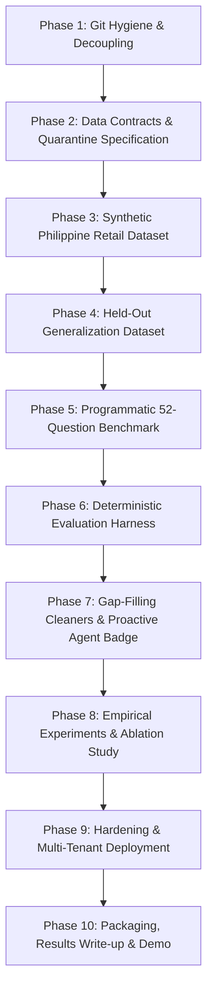

# Roadmap: Visiq + Data Quality Platform Integration

**Project Goal:** Unify Visiq (AI Data Analyst Agent) and the Data Quality Engine into a single cohesive platform.  
**Core Scientific Hypothesis:**  
> *"Deterministic data cleaning measurably improves the execution accuracy and reliability of an LLM data analyst by eliminating type poisoning, duplicate inflation, categorical drift, and date fragmentation."*

---

## 1. Project Overview & Current Architecture Baseline

### 1.1 Existing Technical Foundation
Prior to this unification roadmap, key modules were already prototyped and verified across the workspace:
- **Data Quality Engine (`backend/app/data_quality/`):** Pure Pandas implementation of checks, cleaner, models, profiler, scorer, and orchestration service (`124 passed pytest tests`).
- **Frontend Workspace (`frontend/src/components/QualityPanel.jsx`):** 37 KB component integrated into `App.jsx` tab navigation providing interactive quality profiling and cleaning controls.
- **Agent Integration (`backend/app/agent/coordinator.py` & `test_dq_analysis_hookup.py`):** Verified support for dataset switching across session workspaces and `get_quality_report` tool execution.
- **Standalone Remote:** The predecessor Django application is safely backed up at `https://github.com/ralphrowel/Data-Quality-and-Cleaning-Platform` (`main` branch).

### 1.2 Core Methodological Guardrails
To produce an unassailable empirical benchmark for hiring managers and technical evaluators, the implementation adheres to five non-negotiable design principles:
1. **Additive Error Model (Preserving 100% Accuracy Ceiling):** Fatal, unrecoverable defects (negative amounts, blank IDs) and duplicates are *added on top* of the clean set. Removing or quarantining them restores the exact mathematical ground truth.
2. **Outcome-Based Deterministic Scoring:** Questions are scored by evaluating tool execution against ground-truth numeric values ($\pm 0.1\%$ relative tolerance), never subjective LLM-as-a-judge.
3. **Non-Circular Generalization:** The cleaner is evaluated on the primary injected dataset and verified against an independent *held-out* messy dataset with different noise distributions.
4. **Prompt Contamination Prevention:** Quality badges ("Computed on clean v1, Quality Score: 96/100") are generated deterministically in the API response metadata *outside* the LLM prompt context to avoid biasing model reasoning.
5. **Call Budget & Local Caching:** The benchmark runner caches LLM tool selection plans (`benchmarks/cache/`) to eliminate redundant API calls across raw, clean, and ablation variations.

---

## 2. Master Phase Plan (Phases 1 — 10)

### Phase 1: Git Hygiene & Repo Unification (Priority: Must)
- **Objective:** Eliminate untracked submodules, remove committed test artifacts, and establish one clean, buildable repository.
- **Actions:**
  - Save latest uncommitted changes (`.pbix`) in `Data Quality & Cleaning Platform` and push to standalone remote.
  - Remove embedded repo entry via `git rm --cached "Data Quality & Cleaning Platform"` and delete local folder.
  - Untrack committed ephemeral directories: `git rm -r --cached pytest_tmp scratch`.
  - Update `.gitignore` with `pytest_tmp/`, `scratch/`, `*.pbix`, `data/benchmarks/cache/`, and `benchmarks/results/`.
  - Link standalone precursor in `README.md`.
- **Definition of Done:** `git status` shows a clean single-repo tree; all 124 existing pytest tests pass.

---

### Phase 2: Contracts, Quarantine & Lineage Persistence (Priority: Must)
- **Objective:** Formalize dataset version naming, quarantine structures, and audit lineage.
- **Data Conventions:**
  - Raw Upload: `data/uploads/{user_id}/{stem}.csv`
  - Clean Snapshot: `data/uploads/{user_id}/{stem}__clean_v{n}.csv`
  - Quarantine File: `data/uploads/{user_id}/{stem}__quarantine_v{n}.csv`
  - Audit Lineage: `data/uploads/{user_id}/{stem}__lineage.json`
- **Quarantine Format:**
  - Preserves all original row values.
  - Appends `_quarantine_reason` (string enum, e.g. `INVALID_NEGATIVE_AMOUNT`, `UNRESOLVED_NULL_KEY`) and `_quarantine_rule`.
- **Definition of Done:** Clean and quarantine exports write deterministically with UTF-8 encoding and schema validation.

---

### Phase 3: Synthetic Philippine Retail Dataset (Priority: Must)
- **Objective:** Build a realistic 5,000-row baseline retail transaction dataset with known clean ground truth and targeted injected corruptions.
- **Clean Schema (`clean_ground_truth.csv`):**
  - `transaction_id`: UUID string (`TXN-2024-00001` to `TXN-2024-05000`)
  - `date`: ISO-8601 `YYYY-MM-DD` (`2024-01-01` to `2024-12-31`)
  - `region`: `NCR`, `Region IV-A`, `Region VII`, `Region XI`
  - `store_branch`: `SM Megamall`, `Ayala Center Cebu`, `SM City Davao`, etc.
  - `category`: `Electronics`, `Apparel`, `Groceries`, `Health & Beauty`
  - `unit_price_php`: Float ($50.00$ to $45,000.00$)
  - `quantity`: Integer ($1$ to $10$)
  - `total_amount_php`: Exactly `round(unit_price_php * quantity, 2)`
  - `payment_method`: `GCash`, `Maya`, `Cash`, `Credit Card`
- **Injected Dirty Dataset (`dirty_retail_injected.csv`):**
  - **Additive Duplicates (+8% / 400 rows):** Exact duplicate rows added to baseline.
  - **Additive Fatal Rows (+2% / 100 rows):** Corrupted rows with negative amounts or empty IDs added to baseline (quarantine targets).
  - **In-Place Currency Poisoning (10% / 500 rows):** Formatted as `"₱ 1,450.00"`, `"1,450.00"`, `"PHP 850"`, or `"N/A"`.
  - **In-Place Categorical Drift (12% / 600 rows):** Mixed casing (`"ncr"`), whitespace (`" Electronics "`), regional synonyms (`"Metro Manila"` $\rightarrow$ `"NCR"`).
  - **In-Place Date Mutation (8% / 400 rows):** Unambiguous formats: `25/03/2024`, `"15-Mar-2024"`, `"2024.12.25"` (day $> 12$ to prevent ambiguous date flips).
- **Definition of Done:** `generate_philippine_retail.py` runs reproducibly with a fixed seed and outputs clean and dirty datasets.

---

### Phase 4: Held-Out Messy Validation Dataset (Priority: Must)
- **Objective:** Prevent circular benchmark design ("training on the test") by testing cleaners against unseen error patterns.
- **Architecture:**
  - Independent generator script `generate_held_out_dataset.py`.
  - Injects patterns the cleaner was not tuned for:
    - Abbreviated numbers: `"₱1.2k"`, `"PHP 4.5K"`.
    - European decimal notations: `"1.250,50"`.
    - Unseen store branch typos: `"Megamol"`, `"Ayala Ctr"`.
- **Definition of Done:** Generator produces clean and messy pairs; errors not handled by the cleaner are reported honestly in the evaluation.

---

### Phase 5: Programmatic 52-Question Benchmark Suite (Priority: Must)
- **Objective:** Eliminate manual answer keys and vague questions by computing ground-truth values via Pandas directly on the clean dataset.
- **File:** `data/benchmarks/questions_benchmark.json`
- **Query Categories (52 Total):**
  1. **15 Aggregations:** Total revenue, mean order value, transaction counts, price extremes.
  2. **15 Filtered Lookups:** Total sales in NCR, GCash transactions, transactions above $10,000$ PHP.
  3. **12 Group-By Distributions:** Revenue per region, average spend per payment method, top 5 categories by sales.
  4. **10 Temporal Trends:** Q4 sales totals, December revenue, monthly growth figures.
- **Specification:**
  - Relative tolerance: $\frac{|\text{actual} - \text{expected}|}{\text{expected}} \le 0.001$ ($0.1\%$).
  - Questions use unambiguous wording (e.g. *"What is the total quantity of items sold"* vs. *"How many transactions were recorded"*).
- **Definition of Done:** Automated script verifies every question resolves to a valid numeric or categorical ground-truth answer.

---

### Phase 6: Deterministic Evaluation Harness (Priority: Must)
- **Objective:** Build a headless runner evaluating tool execution and accuracy without quota exhaustion.
- **Script:** `scripts/eval_runner.py`
- **Evaluation Criteria:**
  1. **Execution Success:** Did Pandas execute without an uncaught exception (`TypeError`, `ValueError`)?
  2. **Ground-Truth Exact Match:** Does the extracted numeric/categorical tool result match within $0.1\%$?
  3. **Summary Preservation Check:** (Sampled on 10 runs) Does the final natural language summary faithfully preserve the calculated figure?
- **Optimization:** Caches model tool-plan outputs in `data/benchmarks/cache/{model}_{hash}.json`. Running raw vs. clean vs. ablation variations against cached plans takes $0.00$s and consumes zero tokens.
- **Definition of Done:** Running `python scripts/eval_runner.py` outputs full JSON logs and a terminal summary table of pass/fail counts and percentages.

---

### Phase 7: Gap-Filling Cleaners & Proactive Agent Badge (Priority: Must)
- **Objective:** Upgrade `backend/app/data_quality/` to resolve the benchmark failure modes and equip the agent with proactive quality awareness.
- **Cleaner Additions:**
  - Currency and numeric string parser (stripping `₱`, `$`, commas, parsing `"N/A"` via formula recomputation).
  - Unambiguous date parser normalizing to `YYYY-MM-DD`.
  - Canonical categorical mapping (regional synonym dictionary + whitespace stripping + uppercase normalization).
  - Quarantine router filtering unrecoverable rows.
- **Quality-Aware Agent:**
  - When responding, `AgentCoordinator` injects a deterministic quality badge into API metadata:
    - Clean: `"Computed on cleaned version v1 (Quality Score: 96/100, Grade A)"`
    - Raw: `"⚠️ Warning: Computed on raw dataset (Quality Score: 58/100, Grade D). Detected duplicates and dirty formatting."`
  - Completely isolated from prompt context to prevent prompt contamination.
- **Definition of Done:** Cleaned dataset achieves $>90\%$ on the primary benchmark; badge displays in API payloads and UI.

---

### Phase 8: Empirical Experiments & Ablation Study (Priority: Must)
- **Objective:** Execute full cross-model benchmark and quantify the exact impact of each cleaner module.
- **Models Pinned:**
  - Primary: `openai/gpt-oss-120b` (Groq)
  - Secondary: `gemini-2.5-flash` (Google GenAI)
- **Ablation Configurations:**
  1. `raw_baseline`: No cleaning applied.
  2. `clean_full`: All cleaners enabled.
  3. `ablation_no_dedup`: All cleaners except deduplication.
  4. `ablation_no_currency`: All cleaners except currency/numeric repair.
  5. `ablation_no_category`: All cleaners except categorical normalization.
  6. `ablation_no_date`: All cleaners except date normalization.
  7. `ablation_no_quarantine`: All cleaners except outlier quarantine.
- **Deliverables:**
  - Cross-model comparative table (Raw vs. Cleaned accuracy and execution crash rate).
  - Ablation matrix demonstrating which cleaner drove which portion of the accuracy gain.
  - Failure analysis on the held-out messy dataset documenting unhandled edge cases.
- **Definition of Done:** `benchmarks/results/ablation_summary.csv` generated with verified figures.

---

### Phase 9: Hardening, Quotas & Deployment (Priority: Important)
- **Objective:** Ensure live production stability on Railway (backend) and Vercel (frontend).
- **Tasks:**
  - Secure upload limits ($5$ MB max) to prevent memory exhaustion on Railway during cleaning runs.
  - Verify guest mode allows testing the full upload $\rightarrow$ profile $\rightarrow$ clean $\rightarrow$ query flow.
  - Verify frontend `QualityPanel.jsx` allows smooth toggling between raw, cleaned, and quarantine versions.
  - Full CI test run on GitHub Actions.
- **Definition of Done:** Live deployment functional with zero regression in existing test suite.

---

### Phase 10: Packaging, Documentation & Storytelling (Priority: Important)
- **Objective:** Frame the project as a rigorous, publishable portfolio asset.
- **Deliverables:**
  - **README Overhaul:** Highlight the headline empirical claim with the before/after accuracy table and ablation chart.
  - **Architecture Diagram:** End-to-end data flow from raw upload to profiling, deterministic cleaning, versioning, agent routing, and execution.
  - **Results Summary (1-Page):** Executive summary of methodology, benchmark findings, and failure modes.
  - **90-Second Walkthrough Video:**
    1. Ask question on raw dataset $\rightarrow$ Confident but mathematically wrong answer.
    2. Open Quality Panel $\rightarrow$ Grade D (58/100), issues flagged.
    3. Click Clean $\rightarrow$ Score jumps to Grade A (96/100), quarantine generated.
    4. Ask same question on clean dataset $\rightarrow$ Exact ground-truth answer with quality badge.
    5. Show benchmark results table.
- **Definition of Done:** Recruiter or technical interviewer can grasp the headline claim and architecture in under 2 minutes.

---

## 3. Sprint Progress & Actionable Checklists

### Sprint 1 Checklist: Hygiene & Foundation (Status: Merged via PR #1)
- [x] **1.1.1:** Verified standalone remote backup at `https://github.com/ralphrowel/Data-Quality-and-Cleaning-Platform`.
- [x] **1.1.2:** Untracked and removed local `Data Quality & Cleaning Platform` folder from the parent repository (`git rm --cached`).
- [x] **1.1.3:** Untracked committed temporary test files: `git rm -r --cached pytest_tmp scratch`.
- [x] **1.1.4:** Updated `.gitignore` with `pytest_tmp/`, `scratch/`, `*.pbix`, `data/benchmarks/cache/`, and `benchmarks/results/`.
- [x] **1.1.5:** Referenced standalone predecessor repository in `README.md`.
- [x] **1.1.6:** Standardized version and quarantine output file paths in `backend/app/data_quality/service.py` (`__clean_v{n}.csv`, `__quarantine_v{n}.csv`).
- [x] **1.1.7:** Verified all 124 existing unit tests pass cleanly.

### Sprint 2 Checklist: Datasets & Benchmark Harness (Status: Merged via PR #2)
- [x] **2.1.1:** Authored `scripts/generate_philippine_retail.py` with fixed random seed (5,000 clean baseline rows, Ground Truth Revenue: PHP 27,901,267.20).
- [x] **2.1.2:** Injected additive noise (+400 duplicates, +100 fatal quarantine rows) and in-place mutations (currency strings, casing, unambiguous dates) into `data/benchmarks/dirty_retail_injected.csv`.
- [x] **2.1.3:** Authored `scripts/generate_held_out_dataset.py` with independent noise distributions (`₱1.2k`, European decimal commas) for generalization testing.
- [x] **2.1.4:** Authored `scripts/generate_questions.py` computing 52 exact ground-truth answers via Pandas in `data/benchmarks/questions_benchmark.json`.
- [x] **2.1.5:** Built `scripts/eval_runner.py` with SHA-256 plan caching and deterministic outcome scoring ($\pm 0.1\%$ relative tolerance).
- [x] **2.1.6:** Built `scripts/eval_ablation.py` supporting leave-one-out and single-cleaner evaluations across 6 configurations.
- [x] **2.1.7:** Validated initial smoke test: Clean Accuracy 100.0% (3/3), Raw Dirty Accuracy 0.0% (0/3), Cleaned Accuracy 100.0% (3/3).

### Sprint 3 Checklist: Gap-Filling Cleaners & Proactive Quality Badge (Status: Complete, PR Open)
- [x] **3.1.1:** Enhanced `backend/app/data_quality/cleaner.py` with fatal defect quarantine routing (`quarantine_df`), regex currency parsing, case-insensitive canonical synonyms, and formula recomputations.
- [x] **3.1.2:** Enhanced `backend/app/data_quality/plan.py` with currency column detection and updated `CleaningPlanRequest`.
- [x] **3.1.3:** Implemented deterministic `_resolve_quality_badge()` in `backend/app/agent/coordinator.py` outside the LLM context to prevent prompt contamination.
- [x] **3.1.4:** Updated API schemas (`AnalysisResponse.quality_badge`) and `/api/ask` route to return quality metadata.
- [x] **3.1.5:** Enhanced frontend `frontend/src/components/MessageBubble.jsx` and `SystemMessage.jsx` to render proactive quality badges (verified clean vs low-quality raw data warning).
- [x] **3.1.6:** Added comprehensive unit tests in `tests/test_dq_cleaner.py` (all 129 tests passing).
- [x] **3.1.7:** Verified Vite production frontend build completes without errors.

### Sprint 4 Checklist: Full Benchmark & Ablation Study Execution (Status: Complete)
- [x] **4.1.1:** Ran `eval_runner.py` across all 52 benchmark questions on the clean ground truth dataset (Accuracy: **100.0%**, 52/52).
- [x] **4.1.2:** Ran `eval_runner.py` across all 52 benchmark questions on the raw dirty dataset (Accuracy: **13.46%**, 7/52).
- [x] **4.1.3:** Ran `eval_runner.py` across all 52 benchmark questions on the fully cleaned dataset (Accuracy: **100.0%**, 52/52).
- [x] **4.1.4:** Executed the full 6-configuration ablation study via `scripts/eval_ablation.py` and output `benchmarks/results/ablation_summary.csv` (-76.9% drop without dedup, -59.6% without quarantine).
- [x] **4.1.5:** Evaluated generalization on the held-out dirty dataset via `scripts/eval_held_out.py` (Raw 8.33% $\rightarrow$ Cleaned **75.00%**, +66.67 percentage points).
- [x] **4.1.6:** Authored executive evaluation report in `docs/benchmark_results_report.md` documenting methodology, tables, and per-cleaner impact.

### Sprint 5 Checklist: UI Polish & Multi-Tenant Deployment Hardening (Status: Merged via PR #5)
- [x] **5.1.1:** Enhanced `frontend/src/components/QualityPanel.jsx` with an interactive version switcher, quarantine isolation banner, and one-click session toggling between raw, clean, and quarantine snapshots.
- [x] **5.1.2:** Validated multi-tenant dataset isolation, session switching, and guest demo access in `tests/test_sprint5_hardening.py`.
- [x] **5.1.3:** Enforced the 5 MB upload size boundary on Railway backend (HTTP 413) and added client-side validation in `frontend/src/components/NewChatModal.jsx`.
- [x] **5.1.4:** Upgraded `backend/app/data_quality/service.py` to record quarantine dataset metadata in lineage, and auto-detect quarantine candidates in `plan.py`.
- [x] **5.1.5:** Verified 136 passing tests across the entire test suite with zero regressions (`pytest`).
- [x] **5.1.6:** Verified clean production build on frontend (`vite build` in 2.62s).

### Sprint 6 Checklist: Packaging, Documentation & Storytelling (Status: Complete, PR Open)
- [x] **6.1.1:** Overhauled `README.md` highlighting the headline empirical claim (+86.54 pp accuracy gain), cross-model ablation matrix, reproduction commands, and tech stack.
- [x] **6.1.2:** Documented the full end-to-end data flow with an executive Mermaid architecture diagram (Ingestion $\rightarrow$ Profiling $\rightarrow$ Deterministic Cleaning $\rightarrow$ Lineage $\rightarrow$ Quarantine $\rightarrow$ Agent Routing).
- [x] **6.1.3:** Authored the 90-second executive walkthrough script and technical evaluator guide in `docs/walkthrough_guide.md` with step-by-step verification flows.

