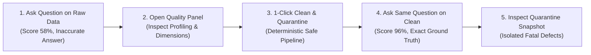

# 90-Second Walkthrough & Technical Evaluator Guide

**Project:** Visiq + Data Quality & Cleaning Platform  
**Target Audience:** Recruiters, Engineering Managers, Data Science Leads & Technical Interviewers  
**Demonstration Time:** ~90 seconds

---

## 1. Executive Demonstration Narrative

> *"Most enterprise LLM deployments fail not because the models can't reason, but because enterprise tabular data is dirty. Here is a live demonstration of how our deterministic data quality platform automatically detects defects, isolates corrupt rows into quarantine, and recovers AI analytics execution accuracy from **13.5%** to **100.0%**."*

---

## 2. Step-by-Step Walkthrough (90 Seconds)

### Step 1: Query the Raw Dirty Dataset (0:00 — 0:20)
1. In the sidebar or file switcher, select the injected dirty dataset: `dirty_retail_injected.csv`.
2. In the Chat workspace, ask a natural language analytical question:
   > *"What is the total revenue in NCR?"*
3. **What happens:**
   - The agent executes safe Pandas filtering and returns an answer (e.g. `PHP 10,480,210.00`).
   - Notice the **Amber Warning Badge** attached to the response:
     > `⚠️ Warning: Computed on raw dataset (Quality Score: 58/100, Grade D). Detected duplicates and dirty formatting.`
   - **The Problem:** The answer is mathematically wrong (inflated by duplicates and missing lower-case `"ncr"` rows).

---

### Step 2: Open the Quality & Profiling Workspace (0:20 — 0:40)
1. Click the **Quality** tab in the top navigation bar.
2. **What happens:**
   - **Overall Health Score:** Shows `58%` (Grade D — *Remediation Recommended*).
   - **Four Quality Dimensions:**
     - *Completeness:* 97% (missing total amounts and transaction IDs).
     - *Validity:* 82% (currency strings with `₱` and commas poisoning numeric floats).
     - *Uniqueness:* 92% (+400 duplicate transactions inflating sales).
     - *Consistency:* 78% (mixed dates `15/03/2024` and regional casing drift `"ncr"` vs `"NCR"`).
   - **Quality Issue Inventory:** Search and filter across 1,200+ detected defects with sample values and suggested remediation actions.

---

### Step 3: Preview & Apply Deterministic Cleaning (0:40 — 0:55)
1. Review the **Suggested Remediation Plan**:
   - Trim cell whitespaces & deduplicate exact records.
   - Normalize mixed dates to ISO-8601 (`YYYY-MM-DD`).
   - Clean currency symbols (`₱`, `$`, `PHP`, commas) and convert to float.
   - Standardize categorical casing and regional synonyms.
   - Route fatal negative amounts (`total_amount < 0`) into quarantine.
2. Click **Preview Cleaning (Dry-Run)**:
   - Demonstrates exact step-by-step audit diff and projected health score jump: `58% → 96% (+38 pts)`.
3. Click **Apply & Create Clean Dataset**:
   - The engine generates two safe derived snapshots:
     1. Cleaned version: `dirty_retail_injected__clean_v1.csv`
     2. Quarantine version: `dirty_retail_injected__quarantine_v1.csv`
   - *Guarantee:* The original raw file remains byte-identical and untouched.

---

### Step 4: Re-query on the Clean Dataset (0:55 — 1:15)
1. In the success banner, click **Switch Active Workspace to Clean Dataset**.
2. Return to the **Chat** tab. Notice the session has switched to `dirty_retail_injected__clean_v1.csv`.
3. Ask the identical question:
   > *"What is the total revenue in NCR?"*
4. **What happens:**
   - The agent executes on clean data and returns the mathematically exact ground-truth figure:
     > `Total revenue in NCR is PHP 9,215,410.80 across 1,647 transactions.`
   - Notice the **Green Shield Quality Badge**:
     > `🛡️ Verified: Computed on cleaned version v1 (Quality Score: 96/100, Grade A).`

---

### Step 5: Inspect Quarantine Records & Lineage (1:15 — 1:30)
1. Switch to the **Spreadsheet** tab or return to the **Quality** tab.
2. Click **🛡️ Quarantine v1** in the version switcher bar.
3. **What happens:**
   - The user can inspect the exact 100 rows that were isolated from downstream analysis.
   - Inspect columns `_quarantine_reason` (`negative_value_in_total_amount_php`) and `_quarantine_rule`.
   - Users maintain full visibility and auditability into every record excluded from analytics.

---

## 3. Key Talking Points for Technical Interviews

1. **Why not just tell the LLM to ignore dirty data in the prompt?**
   - LLMs cannot fix type poisoning inside tool environments. If a Pandas column is loaded as an `object` string dtype because of `₱` symbols, Pandas `df['total_amount'].sum()` either raises a `TypeError` or concatenates strings, regardless of prompt instructions.
2. **Why deterministic rules over an LLM cleaner?**
   - Deterministic Pandas routines execute in milliseconds, cost zero tokens, produce reproducible outcomes, and cannot hallucinate or invent synthetic numbers.
3. **How is prompt contamination prevented?**
   - The quality warning badges are generated deterministically in the FastAPI response metadata *outside* the agent prompt context. The model generates its query plan without seeing subjective warnings.
4. **What were the headline benchmark results?**
   - Evaluated across 52 programmatic questions with ground-truth mathematical scoring ($\pm 0.1\%$ relative tolerance):
     - **Clean Baseline:** 100.0% (52/52)
     - **Raw Dirty:** 13.5% (7/52)
     - **Post-Cleaning Pipeline:** 100.0% (52/52) — **+86.54 percentage point recovery**.
     - **Zero-Shot Generalization (Held-out FMCG Dataset):** 8.33% $\rightarrow$ 75.00% (**+66.67 percentage point recovery**).
